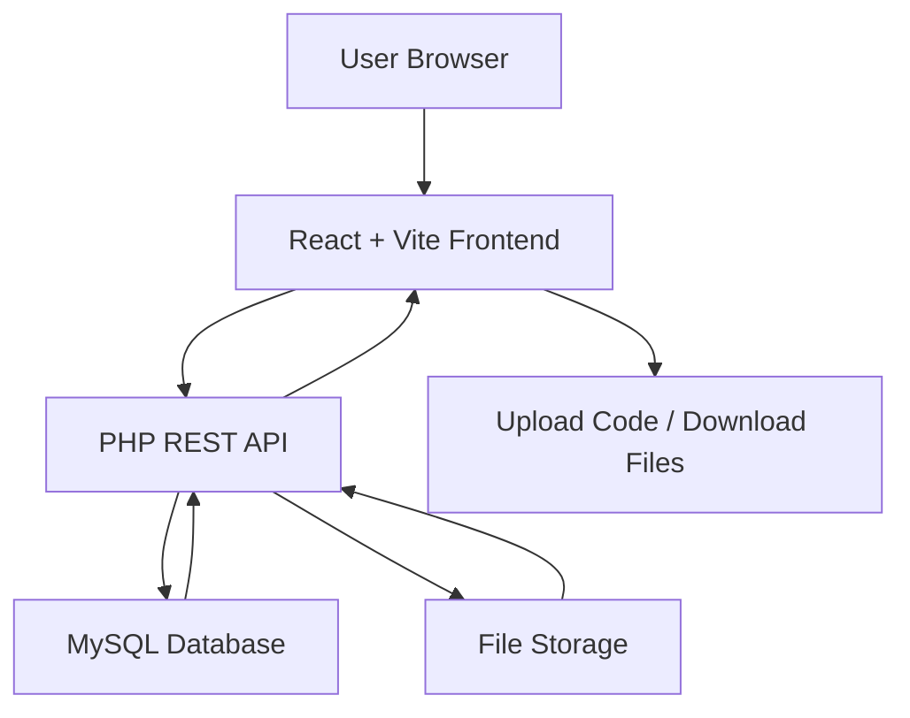
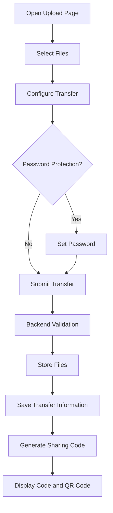
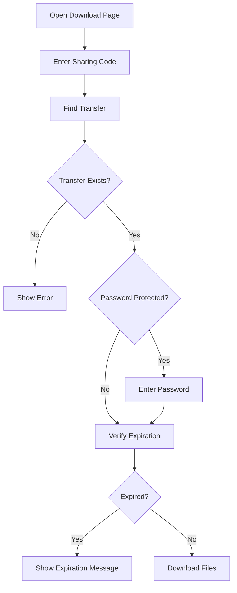

# SYF — Simple File Transfer

**Transfer files easily. Share them securely. No account required.**

[](https://syf.site.je)

**Live Website:** https://syf.site.je

SYF is a simple and user-friendly file transfer platform that allows users to upload files, generate a unique sharing code, and download their files from anywhere using that code.

The platform is built with React, Vite, PHP, and MySQL, focusing on simplicity, security, and temporary file sharing.

---

## Table of Contents

- [Overview](#overview)
- [Features](#features)
- [How SYF Works](#how-syf-works)
- [User Guide](#user-guide)
- [Technology Stack](#technology-stack)
- [Project Structure](#project-structure)
- [Installation](#installation)
- [Configuration](#configuration)
- [Security](#security)
- [Live Website](#live-website)

---

## Overview

SYF makes file sharing simple:

1. Upload one or multiple files.
2. Optionally protect the transfer with a password.
3. Choose an expiration period.
4. Generate a unique five-character sharing code.
5. Share the code with the recipient.
6. The recipient enters the code and downloads the files.

No account registration is required.

## Features

- **Multiple File Uploads:** Upload multiple files in a single transfer.
- **Unique Sharing Codes:** Each transfer receives a unique five-character code.
- **Password Protection:** Optionally secure transfers with a password.
- **Automatic Expiration:** Choose how long files remain available.
- **QR Code Sharing:** Make sharing easier using a QR code.
- **File Download:** Retrieve shared files using their transfer code.
- **Responsive Design:** Works on desktop, tablet, and mobile devices.
- **Secure Backend:** Includes server-side validation, protected storage, and API rate limiting.
- **Simple Interface:** A clean and straightforward user experience.

### Upload Limits

| Setting | Limit |
|---|---|
| Maximum files per transfer | 20 |
| Maximum total upload size | 10 MB |
| Sharing code length | 5 characters |
| Expiration options | 24, 48, 72, or 168 hours |

### Supported File Types

- Documents: PDF, TXT, CSV
- Images: JPG, JPEG, PNG, GIF, WebP
- Office files: DOC, DOCX, XLS, XLSX, PPT, PPTX
- Archives: ZIP

---

## How SYF Works

### System Architecture



### File Upload Workflow



### File Download Workflow



---

## User Guide

### 1. Upload Files

1. Visit the [SYF website](https://syf.site.je).
2. Navigate to the Upload page.
3. Select the files you want to share.
4. Configure the transfer settings.
5. Optionally add a password.
6. Select an expiration period.
7. Start the upload.

### 2. Share Your Files

After a successful upload, SYF generates:

- A unique five-character sharing code.
- A QR code for convenient sharing.

Send the sharing code or QR code to the recipient.

### 3. Download Files

1. Open the Download page.
2. Enter the sharing code.
3. Enter the password if the transfer is protected.
4. Access and download the shared files.

### 4. Transfer Expiration

Transfers are temporary. Once the selected expiration period is reached, the transfer is no longer available for downloading.

---

## Technology Stack

| Technology | Purpose |
|---|---|
| React | Frontend user interface |
| Vite | Frontend development and build tool |
| Tailwind CSS | Styling and responsive design |
| PHP | Backend API |
| MySQL | Database management |
| Apache | Web server |
| Git & GitHub | Version control |
| InfinityFree | Hosting |

---

## Project Structure

```text
SYF/
│
├── syf/                       # React frontend
│   ├── public/
│   ├── src/
│   │   ├── assets/
│   │   ├── components/
│   │   ├── pages/
│   │   ├── config/
│   │   └── ...
│   ├── .env.example
│   └── package.json
│
├── syf-backend/               # PHP backend
│   ├── api/
│   │   ├── upload.php
│   │   ├── package.php
│   │   └── download.php
│   ├── config/
│   ├── controllers/
│   ├── models/
│   ├── services/
│   ├── storage/
│   └── .htaccess
│
└── README.md
```

*The structure above is a simplified overview of the main project directories.*

---

## Installation

Follow these steps to run SYF locally.

### Prerequisites

- Node.js and npm
- PHP 8+
- MySQL
- Apache (XAMPP recommended)
- Git

### 1. Clone the Repository

```bash
git clone https://github.com/azadinjn/SYF.git
cd SYF
```

### 2. Setup the Backend

Copy the `syf-backend` directory into your XAMPP `htdocs` directory.

Example:

```text
C:/xampp/htdocs/syf-backend
```

Create a MySQL database and import the project's database schema.

Configure your local database connection using the backend's local configuration.

Make sure the required PHP extensions are enabled:

- PDO
- pdo_mysql
- fileinfo
- zip

### 3. Setup the Frontend

Open the frontend directory:

```bash
cd syf
```

Install dependencies:

```bash
npm install
```

Configure the API URL in `.env.development`:

```env
VITE_API_URL=http://localhost/syf-backend/api
```

### 4. Run the Application

Start Apache and MySQL from XAMPP.

Then start the frontend:

```bash
npm run dev
```

Open the local development URL displayed by Vite, usually:

```text
http://localhost:5173
```

### 5. Build for Production

```bash
npm run build
```

The production files are generated inside the `dist` directory.

---

## Configuration

The frontend uses the following environment variable:

| Variable | Description |
|---|---|
| `VITE_API_URL` | Base URL of the PHP API |

Example:

```env
VITE_API_URL=https://your-domain.com/syf-backend/api
```

**Important:** Never commit production database credentials, passwords, private configuration files, or other secrets to GitHub.

Use local configuration files for sensitive settings and keep them excluded through `.gitignore`.

---

## Security

SYF includes several security measures:

- Server-side file type and size validation.
- Password hashing for protected transfers.
- Restricted access to internal backend directories.
- Protected file storage.
- API rate limiting.
- CORS origin restrictions.
- HTTP security headers.
- Automatic transfer expiration.
- Database access through PDO.

Security is an ongoing process, and production configuration should be reviewed whenever the application changes.

---

## Live Website

<https://syf.site.je>

Try SYF and experience simple file sharing without creating an account.

---

## Author

**Azeddine Jannane**

Web Full Stack Development Student

- GitHub: [@azadinjn](https://github.com/azadinjn)
- Project: [SYF](https://syf.site.je)

---

## License

This project is available for educational and portfolio purposes. Contact the author for other usage or distribution permissions.

---

**SYF — Simple. Secure. Share.**
## Current Status

The main frontend and backend features have been implemented and tested locally.

Deployment configuration and production testing are still pending.

## License

This project is currently developed as an educational and portfolio project.
